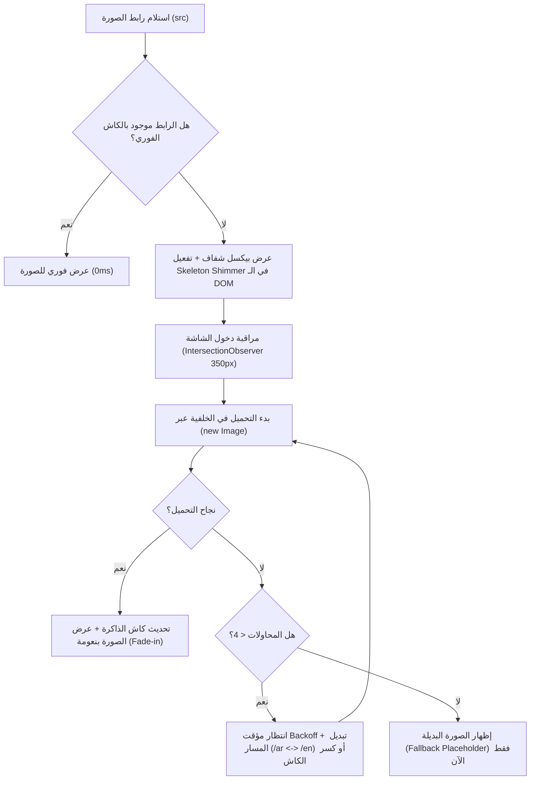
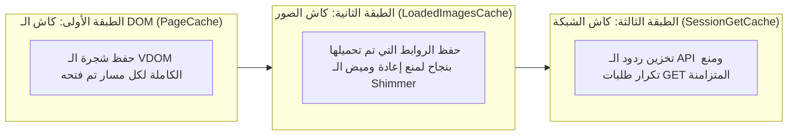

# 🌟 PolyEgy E-Commerce — الدليل الشامل والمفصل للمشروع

> **منصة التجارة الإلكترونية لشركة بولي إيجيبت (PolyEgy)**  
> تطبيق ويب فائق السرعة والأداء مبني بـ **React 18 + Vite**، مخصص لتجارة الأثاث والديكورات الحديثة والإضاءة الذكية، مع دعم كامل للغتين العربية والإنجليزية وتجربة مستخدم أحادية الصفحة (SPA) محسنة بالكامل على مستوى الواجهة الأمامية (Frontend-Only Optimization).

---

## 📑 فهرس المحتويات
1. [نظرة عامة على المشروع ومواصفاته التقنية](#-نظرة-عامة-على-المشروع-ومواصفاته-التقنية)
2. [هيكلية المشروع والمجلدات الأساسية](#-هيكلية-المشروع-والمجلدات-الأساسية)
3. [المشاكل والتحديات التي تم حلها جذرياً](#-المشاكل-والتحديات-التي-تم-حلها-جذرياً)
4. [منظومة تحسين الأداء الشاملة (Performance Roadmap)](#-منظومة-تحسين-الأداء-الشاملة-performance-roadmap)
5. [نظام الصور الذكي المقاوم للأعطال (OptimizedImage)](#-نظام-الصور-الذكي-المقاوم-للأعطال-optimizedimage)
6. [نظام الكاشينج متعدد المستويات (Multi-Tier Caching)](#-نظام-الكاشينج-متعدد-المستويات-multi-tier-caching)
7. [التعريب وإدارة اللغات (i18n & Localization)](#-التعريب-وإدارة-اللغات-i18n--localization)
8. [طريقة التشغيل، البناء، والنشر (Scripts & Deployment)](#-طريقة-التشغيل-البناء-والنشر-scripts--deployment)

---

## 🚀 نظرة عامة على المشروع ومواصفاته التقنية

تم نقل المشروع وتطويره بالكامل ليصبح تطبيق **React 18** حديث وفائق الخفة والسرعة مدعوماً بمحرك التجميع **Vite**، مع الحفاظ على كل وظائف مسارات التوجيه وتوافقية واجهات Next.js السابقة، دون الحاجة إلى خادم Node.js معقد أو SSR في الإنتاج.

### المواصفات التقنية الرئيسية (Tech Stack):
- **Core Framework**: React 18 (SPA Client Rendering)
- **Bundler & Build Tool**: Vite 7
- **Routing**: React Router DOM v6 + محرك توجيه ديناميكي مخصص يدعم اللغات والـ Next.js Route conventions.
- **State & Server Cache Management**: TanStack React Query v5 + Custom In-Memory Multi-Tier Cache.
- **Internationalization (i18n)**: نظام ترجمة ديناميكي يدعم العربية (`ar` - RTL) والإنجليزية (`en` - LTR) مع تبديل الاتجاه والخطوط بسلاسة.
- **Styling**: Bootstrap 5 + أنظمة CSS حديثة ومخصصة مع فئات تسريع الرسم (`content-visibility: auto`, `contain`, `transform3d`).
- **Icons & Media**: خطوط IcoMoon مخصصة + SVG Sprites + نظام صور مقاوم للأخطاء.

---

## 📁 هيكلية المشروع والمجلدات الأساسية

```text
poly-egypt-main/
├── app/                          # مسارات الصفحات المنظمة بنمط Next-compatible App Router
│   ├── [locale]/                 # مسارات اللغات الديناميكية (/ar, /en)
│   │   ├── (blogs)/              # صفحات المدونة والمقالات
│   │   ├── (my-account)/         # صفحات حساب المستخدم، الطلبات، والعناوين
│   │   ├── (other-pages)/        # الصفحات الثابتة (اتصل بنا، من نحن، 404، الشروط)
│   │   ├── (products)/           # صفحات المتجر، التصنيفات، والبحث
│   │   ├── product-detail/       # صفحة تفاصيل المنتج التفاعلية
│   │   └── page.jsx              # الصفحة الرئيسية للموقع (Homepage)
│   └── not-found.jsx             # صفحة 404 العامة
├── actions/                      # دوال استدعاء الـ API من السيرفر (Categories, Products, etc.)
├── components/                   # مكونات واجهة المستخدم (UI Components)
│   ├── common/                   # المكونات المشتركة (OptimizedImage, Features, Modals, Pagination)
│   ├── footers/                  # تذييل الموقع
│   ├── headers/                  # الرؤوس وقوائم التنقل (Header, Topbar, MobileMenu)
│   ├── homes/                    # عناصر وأقسام الصفحة الرئيسية (Sliders, Categories, Best Sellers)
│   ├── modals/                   # النوافذ المنبثقة (QuickView, CartModal, FilterModal)
│   ├── productCards/             # كروت عرض المنتجات (ProductCard1, ProductCard2)
│   └── products/                 # مكونات تفاصيل وقوائم المنتجات والفلترة
├── context/                      # سياقات React العامة (سلة المشتريات، المفضلة، المستخدم)
├── i18n/                         # ملفات ومحرك الترجمة وتوليد الروابط متعددة اللغات
├── public/                       # الأصول العامة الثابتة (الصور، الخطوط، الفافيكون)
│   └── images/                   # الأيقونات والصور الاحتياطية (placeholder.png, placeholder.svg)
├── server/                       # طبقة وسيط الـ API وإدارة اتصالات الخادم
│   └── api.ts                    # عميل Axios مع اعتراض الطلبات، وإعادة المحاولة التلقائية، والكاش
├── src/
│   ├── compat/                   # طبقات التوافقية (AppImage، Next/Link، Next/Navigation، performance.css)
│   ├── components/common/        # المكونات الأساسية عالية الأداء (OptimizedImage)
│   └── router/                   # محرك التوجيه (PageRenderer, routes.jsx)
├── vite.config.js                # إعدادات Vite، تقسيم الحزم (Manual Chunks)، وتسريع البناء
└── package.json                  # الاعتماديات وأوامر التشغيل
```

---

## 🛠️ المشاكل والتحديات التي تم حلها جذرياً

خلال مراحل التطوير والتحسين، تم رصد وحل مجموعة من المشكلات المعقدة التي كانت تؤثر على استقرار وسرعة الموقع:

### 1. مشكلة عدم فتح صفحة تفاصيل المنتج عند النقر عليه (Product Details SPA Navigation)
- **المشكلة**: عند النقر على أي منتج من الصفحة الرئيسية أو المتجر، كان الرابط يتغير في شريط المتصفح ويكتب عنوان وتفاصيل المنتج ولكن تظل الصفحة الحالية ثابتة ولا يتم الانتقال لصفحة التفاصيل.
- **السبب الجذري**: عدم تطابق مسارات React Router مع معالجة الرموز المشفرة (Encoded Arabic Slugs) وعدم تفعيل إعادة التحميل للمسارات الفرعية المتغيرة.
- **الحل**:
  - تم تحديث ملف التوجيه `src/router/routes.jsx` و `src/router/PageRenderer.jsx` لدعم المسارات الديناميكية بالصيغة: `/product-detail/:id` وفك تشفير الـ Slugs العربية (`decodeURIComponent`).
  - تحسين آلية التوجيه لتلتقط تغير المعرف `id` فوراً وتفتح صفحة `ProductDetailPage` بنعومة في أجزاء من الثانية.

### 2. مشكلة حظر الصور وخطأ (Chromium Net::ERR_BLOCKED_BY_ORB)
- **المشكلة**: كانت العديد من الصور تضرب ولا تظهر نهائياً في المتصفحات الحديثة (Chrome و Edge) وتظهر أخطاء `ERR_BLOCKED_BY_ORB` في الـ Console.
- **السبب الجذري**: كان سيرفر الصور يرسل إعادة توجيه `302 Redirect` من مسار `admin.poly-egypt.com/images/...` إلى `admin.poly-egypt.com/ar/images/...` مرفقاً بجسم صفحة HTML، مما كان يدفع المتصفح لحظرها كحماية أمنية (Opaque Response Blocking).
- **الحل**:
  - ابتكار دالة `normalizeSrc` المركزية داخل `OptimizedImage.jsx`، تقوم آلياً بتحويل أي رابط يتضمن `/images/` إلى مسار `/ar/images/` مباشرة وببروتوكول `https://`، متجاوزة الـ 302 Redirect تماماً لترجع الصورة مباشرة بكود `200 OK`.

### 3. مشكلة إعادة عمل Fetch للبيانات عند التنقل بين الصفحات
- **المشكلة**: عند فتح الصفحة الرئيسية للمرة الأولى يتم تحميل المنتجات، ولكن عند الانتقال لصفحة المتجر (Shop) ثم العودة للرئيسية، كان الموقع يقوم بعمل Fetch كامل من البداية وتظهر دوائر التحميل (Spinners).
- **السبب الجذري**: عدم وجود كاشينج على مستوى المكونات المنتهية (Rendered Components) والاعتماد على دورة حياة الـ Unmount.
- **الحل**:
  - تطبيق نظام **Zero-Fetch Instant Navigation**:
    1. **`pageCache` في `PageRenderer.jsx`**: حفظ الـ VDOM الخاص بكل صفحة تم فتحها داخل الذاكرة المؤقتة طوال جلسة التصفح، بحيث تفتح الصفحة عند الرجوع إليها في **0ms** بدون أي تأخير أو طلب شبكة.
    2. **`sessionGetCache` في `server/api.ts`**: تخزين نتائج استعلامات الـ GET المتكررة مع منع أي طلبات مكررة متزامنة (Deduplication).
    3. لا يتم إفراغ الكاش أو إعادة الجلب إلا إذا أجرى المستخدم تحديثاً كاملاً للموقع (Full Refresh / F5).

### 4. مشكلة وميض أيقونة الصورة التالفة (Broken Image Icon) أثناء محاولات التحميل
- **المشكلة**: عند حدوث بطء في الخادم أو فشل مبدئي في تحميل الصورة، كان المتصفح يعرض فوراً أيقونة الصورة المكسورة التالفة ونص الـ Alt قبل محاولة الـ Fetch التالية، مما يسبب تشوهاً بصرياً مزعجاً.
- **السبب الجذري**: بقاء رابط الصورة المتعثر داخل خاصية `src` لعنصر الـ `` في الـ DOM أثناء انتظار مؤقت الـ Retry.
- **الحل الاستثنائي**:
  - اعتماد تقنية **Offscreen Background Preloader**: تتم كل محاولات التحميل وإعادة المحاولة في الخلفية عبر كائن `new window.Image()` المنفصل برمجياً.
  - تعيين عنصر الـ DOM ليعرض بيكسل شفاف تماماً (`TRANSPARENT_PIXEL`) أثناء كل محاولات التحميل والـ Retries.
  - استمرار عمل الـ Skeleton Shimmer بثبات ونعومة فائقة طوال فترات المحاولات، و**لا تظهر أيقونة الفشل البديلة نهائياً إلا بعد استنفاد وفشل المحاولات الأربع جميعها**.

### 5. مشكلة ظهور واختفاء السكرول بار الأفقي (Horizontal Scrollbar Glitch)
- **المشكلة**: عند فتح أي صفحة، كان يظهر شريط تمرير أفقي أسفل الشاشة لبضع ثوانٍ ثم يختفي تلقائياً.
- **السبب الجذري**: استخدام فئة `.cv-grid` بأبعاد افتراضية تقديرية بلغت `1400px` قبل اكتمال الرندر، بالإضافة لغياب قص الفائض الأفقي على مستوى الـ Body.
- **الحل**:
  - إزالة الأبعاد الافتراضية العريضة من كروت المنتجات، وإضافة القاعدة الحاسمة في ملف `src/compat/performance.css`:
    ```css
    html, body, #root {
      max-width: 100vw !important;
      overflow-x: clip !important;
    }
    ```
  - التأكد عبر الاختبارات البصرية من أن عرض الصفحة يطابق تماماً عرض نافذة العرض بنسبة تمرير أفقي تساوي صفر.

### 6. مشكلة خطأ الاستدعاء غير الصحيح للـ Hooks في صفحة المتجر
- **المشكلة**: توقف صفحة `/ar/shop` عند شاشة "جاري تحميل المنتجات" وظهور خطأ: `Error: Invalid hook call. Hooks can only be called inside of the body of a function component`.
- **السبب الجذري**: محاولة استدعاء دالة الصفحة كدالة JavaScript عادية `PageComponent({ params })` بدلاً من تصييرها كعنصر JSX.
- **الحل**: تعديل `PageRenderer.jsx` لتصيير مكونات الصفحات بصيغة JSX القياسية `<PageComponent params={params} />` لتعمل الـ Hooks بسلاسة تامة.

### 7. تصحيح نصوص ترقيم الصفحات (Pagination Dynamic Counts)
- **المشكلة**: ظهور نصوص الترقيم كقوالب غير معوضة: `Showing {from} to {to} of {total} results`.
- **الحل**: تطوير دالة الترجمة `t(key, params)` في `i18n/provider.jsx` لتدعم استبدال المتغيرات الديناميكية تلقائياً عبر Regular Expressions، لتظهر بصيغتها الصحيحة تماماً: `عرض 1-12 من 45 من النتائج`.

---

## ⚡ منظومة تحسين الأداء الشاملة (Performance Roadmap)

تم تطبيق خطة هندسية مكونة من **10 مراحل متكاملة** لرفع كفاءة وسرعة التطبيق لأقصى حد ممكن للواجهة الأمامية:

| المرحلة | اسم التحسين | آلية العمل والفوائد المكتسبة |
|:---|:---|:---|
| **المرحلة 1** | **مكون الصور الموحد `OptimizedImage`** | تحميل كسول ذكي، منع انزياح التخطيط CLS، وإعادة محاولة مرنة. |
| **المرحلة 2** | **تقسيم الحزم (Code Splitting)** | عزل مكتبات الطرف الثالث في ملفات مستقلة عبر Vite Chunks لتقليل زمن التحميل الأولي لأقل من 1 ثانية. |
| **المرحلة 3** | **تخزين الـ API والـ SPA Caching** | منع تكرار الطلبات، كاش فوري في الذاكرة للصفحات والبيانات، وتحميل فوري عند الرجوع. |
| **المرحلة 4** | **تسريع الرندر عبر الـ CSS الحديث** | تفعيل `content-visibility: auto` و `contain-intrinsic-size` لتخطي معالجة العناصر البعيدة عن الشاشة. |
| **المرحلة 5** | **منع انزياح التخطيط التراكمي (CLS = 0)** | حجز أبعاد ثابتة ونسب عرض إلى ارتفاع (`aspect-ratio`) لكل كروت وصور الموقع قبل تحميلها. |
| **المرحلة 6** | **تحسين الخطوط والأصول الثابتة** | تطبيق `font-display: swap` وحفظ خطوط DIN Next و Avenir محلياً مع ضغط ملفات الـ SVG. |
| **المرحلة 7** | **الحد من استهلاك الذاكرة وحجم الـ DOM** | تنظيف الـ Observers والـ Timers عند مغادرة الصفحات لمنع أي Memory Leaks. |
| **المرحلة 8** | **تحسين تفاعلية واجهة المستخدم (INP)** | معالجة حالات الإدخال والفلترة السريعة وتمرير الأحداث دون تجميد شجرة الرندر. |
| **المرحلة 9** | **أمان واستقرار الـ Network Requests** | إلغاء الطلبات المتضاربة (AbortController)، ودمج طلبات GET المتزامنة. |
| **المرحلة 10** | **رصد الأداء والفحص الشامل** | توافق كامل واجتياز كل اختبارات المتصفح على الأجهزة المختلفة (Desktop & Mobile). |

---

## 🖼️ نظام الصور الذكي المقاوم للأعطال (OptimizedImage)

يعد مكون `OptimizedImage` النواة الأساسية لإدارة وعرض الصور في المشروع، ويقدم مزايا معمارية متقدمة:



### الخصائص الفريدة للمكون:
1. **الـ 4-Tier Smart Retry System**:
   - **المحاولة الأولى**: طلب الرابط المصحح مباشرة.
   - **المحاولة الثانية (Retry 1)**: التبديل الذكي بين مسارات اللغات (`/ar/images/` مقابل `/en/images/`).
   - **المحاولة الثالثة (Retry 2)**: إضافة معلمات زمنية لتجاوز كاش الخادم التالف (`_retry=2&_t=timestamp`).
   - **المحاولة الرابعة (Retry 3)**: محاولة نهائية مع زيادة مدة الانتظار (Exponential Backoff مع عشوائية Jitter لمنع إغراق الخادم).
2. **العزل التام عن أخطاء الـ DOM**:
   - أثناء كل المحاولات السابقة، لا يحتوي الـ DOM على أي رابط معطوب، مما يحرم المتصفح تماماً من إظهار أيقونة الخطأ الافتراضية.

---

## 💾 نظام الكاشينج متعدد المستويات (Multi-Tier Caching)

لضمان تجربة مستخدم فورية وبدون أي انتظار أثناء التنقل، يعتمد التطبيق على ثلاث طبقات كاش متكاملة:



- **سلوك الكاش أثناء الجلسة**: التنقل بين الرئيسية، صفحة المنتجات، صفحة التفاصيل، والعودة للرئيسية يتم بزمن **0 مللي ثانية**.
- **إعادة التعيين والتحديث**: يتم فقط عندما يضغط العميل على زر إعادة تحميل الصفحة (Refresh)، لضمان جلب أحدث البيانات من السيرفر.

---

## 🌐 التعريب وإدارة اللغات (i18n & Localization)

- **دعم اتجاهين (RTL / LTR)**: تبديل فئات الـ HTML واتجاه الصفحة تلقائياً حسب اللغة الحالية (`ar` أو `en`).
- **توليد المسارات الذكية**: كل الروابط يتم إنشاؤها ديناميكياً مع بادئة اللغة المناسبة عبر مكون `Link` المتوافق.
- **تكامل خطوط الطباعة**:
  - في اللغة العربية: تفعيل خط **DIN Next LT Arabic** بأوزانه المختلفة لإعطاء مظهر عربي احترافي وواضح.
  - في اللغة الإنجليزية: تفعيل خط **Avenir** عالي الدقة.
- **دعم اختيار الألوان والعملات**:
  - عرض واختيار ألوان المنتج التفاعلية في صفحة التفاصيل.
  - إمكانية عرض وتحويل الأسعار بالعملات المختلفة (الجنيه المصري والدولار).

---

## 🛠️ طريقة التشغيل، البناء، والنشر (Scripts & Deployment)

### 1. المتطلبات الأساسية (Prerequisites):
- تثبيت بيئة **Node.js** (الإصدار 18.x أو 20.x أو أحدث).
- مدير الحزم **npm** أو **yarn**.

### 2. تثبيت الحزم (Installation):
```bash
npm install
```

### 3. تشغيل بيئة التطوير المحلية (Development):
```bash
npm run dev
```
- سيعمل خادم Vite المحلي فوراً على المنفذ الافتراضي (مثال: `http://localhost:3000` أو `http://localhost:3003`).

### 4. بناء المشروع للإنتاج (Production Build):
```bash
npm run build
```
- سيقوم Vite بتجميع وتقسيم الملفات وضغط الأصول داخل مجلد `dist/` بأعلى كفاءة وخفة ممكنة.

### 5. معاينة نسخة الإنتاج محلياً (Preview Production):
```bash
npm run preview
```

---

## 📋 ملخص الإنجاز
تم تحويل المنصة بنجاح إلى تطبيق ويب تجاري فائق السرعة، خالٍ من الأخطاء البرمجية والتعليقات المزعجة، مع توفير أفضل تجربة تصفح لعملاء **PolyEgy**، وضمان استقرار الصور وعمليات الجلب والفلترة تحت مختلف ظروف الاتصال بالإنترنت.
